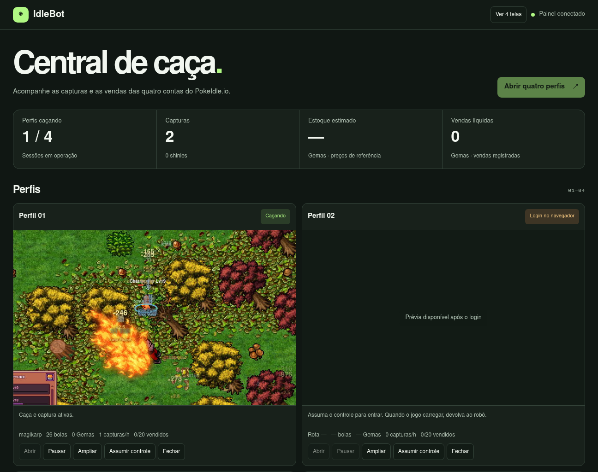

<h1 align="center">PokeIdle Autopilot</h1>

<p align="center">
  <strong>Caça, captura e vendas no PokeIdle.io para até quatro contas próprias.</strong><br>
  Windows e Docker · Painel em português · Monitoramento pelo celular
</p>

<p align="center">
  <a href="#instalação">Instalar</a> ·
  <a href="#acompanhe-pelo-celular">Acessar pelo celular</a> ·
  <a href="docs/pokeidle.md">Guia do jogo</a>
</p>

<p align="center">
  
</p>

<p align="center"><sub>Charmander em uma caça na rota de Metapod no PokeIdle.io.</sub></p>

O **IdleBot** acompanha as sessões do jogo em um único painel. Depois do primeiro login, cada perfil caça, repõe suprimentos e tenta capturar Pokémon. Quando encontra um Pokémon elegível, consulta vendas comparáveis e pode anunciá-lo no Mercado da Comunidade.

A meta de cada perfil é de **20 Pokémon vendidos em Gemas**. O painel mostra vendas confirmadas e anúncios em andamento separadamente. Ao confirmar a 20ª venda no extrato do jogo, o robô encerra a sessão e mantém o progresso salvo para a próxima abertura.

## Da caça à venda

| Etapa | O que o IdleBot faz |
| --- | --- |
| 🗺️ **Caça** | Avança entre rotas liberadas, recua quando o time sofre desmaios e usa as opções de cura do jogo. |
| 🔴 **Captura** | Usa o botão comum de arremesso, disponível em contas gratuitas. Registra as capturas confirmadas pelo servidor. |
| 💎 **Mercado** | Estima preços com base em pelo menos três vendas comparáveis. Protege iniciais, Pokémon da equipe e Pokémon marcados na Coleção. |
| 📊 **Acompanhamento** | Mostra capturas, anúncios, vendas e a meta por perfil. No Docker, **Ver 4 telas** abre as transmissões lado a lado. |

<p align="center">
  
</p>

<p align="center"><sub>Painel em modo Docker, com os perfis identificados pelo número.</sub></p>

## Instalação

Baixe e extraia o [ZIP do projeto](https://github.com/cristianpaxur/PokeIdle-Autopilot/archive/refs/heads/main.zip) e abra **Instalar IdleBot.cmd**. O instalador prepara o Docker e abre o QR code do celular. Pelo Git, use estes comandos no PowerShell.

```powershell
git clone https://github.com/cristianpaxur/PokeIdle-Autopilot.git
cd PokeIdle-Autopilot
.\scripts\install-windows.ps1
```

Abra o [painel local](http://127.0.0.1:4097) e entre com o usuário `idlebot` e a senha gerada no arquivo `.env.docker`. No primeiro acesso de cada perfil, clique em **Assumir controle**, faça o login no PokeIdle.io e clique em **Devolver ao robô** quando o jogo carregar.

**Quer que uma IA instale no seu Windows?** Envie o link deste repositório a uma IA com acesso ao computador e use este pedido.

> Baixe este repositório, execute o instalador do IdleBot neste Windows e deixe o QR do celular aberto. Siga o AGENTS.md e acompanhe a instalação até o painel e o monitor responderem.

O [guia de instalação](docs/instalacao.md) detalha os pré-requisitos, o primeiro acesso e a configuração remota. O [AGENTS.md](AGENTS.md) orienta a IA durante a instalação.

## Acompanhe pelo celular

Escaneie o QR que o instalador abre no PC. O monitor funciona no navegador do celular, inclusive pelo 4G ou 5G, enquanto o PC e o Docker estiverem ativos. Você pode acompanhar as vendas e abrir as transmissões da caça em modo de visualização.

Para rever o código, clique em **QR do celular**, no topo do painel do PC. Se o endereço temporário mudar, escaneie o QR atualizado.

<details>
<summary><strong>Configuração opcional por perfil</strong></summary>

Crie `idlebot.local.json` na raiz do projeto. O array `profiles` corresponde aos perfis 01 a 04. Os perfis omitidos usam os padrões.

```json
{
  "port": 4096,
  "channel": "msedge",
  "profiles": [
    {
      "autoStart": false,
      "hunt": "",
      "goldReserve": 10000,
      "maxListingFee": 100000,
      "marketEnabled": true,
      "withdrawal": {
        "enabled": false,
        "wallet": "",
        "maxGems": 1000,
        "reserveGems": 0,
        "intervalHours": 24
      }
    }
  ]
}
```

- Com `hunt` vazio, o IdleBot progride entre rotas. Informe o slug da rota para fixá-la.
- `goldReserve` protege uma reserva de ouro. `maxListingFee` limita o custo de estadia de cada anúncio.
- Com `marketEnabled: false`, o perfil deixa de criar anúncios. O saque exige ativação explícita e o endereço público de uma carteira Solana.

No Docker, copie o arquivo para o volume do serviço e reinicie para aplicar.

```powershell
docker compose --env-file .env.docker cp idlebot.local.json idlebot:/data/idlebot.local.json
docker compose --env-file .env.docker restart idlebot
```

</details>

<details>
<summary><strong>Rodar sem Docker</strong></summary>

Com Node.js 24 ou mais recente e Microsoft Edge instalado, execute os comandos abaixo. A configuração aceita também o canal `chrome`.

```powershell
npm ci
npm start
```

Abra o [painel local](http://127.0.0.1:4096) e inicie o **Perfil 01**. Faça login na janela do jogo e feche-a depois que a sessão carregar. O IdleBot reabre o mesmo perfil e retoma a sessão. Os dados locais ficam em `%LOCALAPPDATA%\IdleBot`.

Para rodar os testes, use `npm test`. Os testes de navegador usam o Microsoft Edge e páginas de teste locais.

</details>

## Jogo e créditos

PokeIdle Autopilot é um projeto comunitário independente para contas próprias. Os [termos do PokeIdle.io](https://pokeidle.io/terms) permitem automação dentro dos limites do jogo. As vendas dependem de compras de outros jogadores no Mercado da Comunidade.

A animação mostra uma sessão no [PokeIdle.io](https://pokeidle.io/). A arte exibida no jogo pertence aos respectivos titulares.
