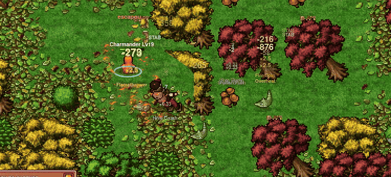

<h1 align="center">PokeIdle Autopilot</h1>

<p align="center">
  <strong>Automatize a caça e as vendas no PokeIdle.io em até quatro contas próprias.</strong><br>
  Windows e Docker · Painel em português · Monitoramento pelo celular
</p>

<p align="center">
  <a href="#instalação">Instalar</a> ·
  <a href="#modos-de-caça">Modos de caça</a> ·
  <a href="#planejador-por-perfil">Planejador</a> ·
  <a href="#monitor-no-celular">Monitor no celular</a> ·
  <a href="docs/pokeidle.md">Guia do jogo</a>
</p>

<p align="center">
  
</p>

## Instalação

1. Baixe e extraia o [ZIP do projeto](https://github.com/cristianpaxur/PokeIdle-Autopilot/archive/refs/heads/main.zip) no Windows.
2. Abra **Instalar IdleBot.cmd**. O instalador prepara o Docker Desktop e abre o QR do monitor quando ele estiver disponível.
3. Abra o [painel local](http://127.0.0.1:4097) com o usuário `idlebot` e a senha gerada no arquivo `.env.docker`, na pasta do projeto.
4. Em cada perfil que quiser usar, clique em **Assumir controle**, entre na sua conta do PokeIdle.io e clique em **Devolver ao robô** quando o jogo carregar.

Se o Windows ou o Docker pedir uma confirmação ou reinício, conclua a etapa e execute o instalador novamente. O [guia de instalação](docs/instalacao.md) também explica como pedir a instalação a uma IA com acesso ao PC.

<details>
<summary><strong>Instalar ou atualizar pelo Git</strong></summary>

No PowerShell, clone o repositório e execute o instalador.

```powershell
git clone https://github.com/cristianpaxur/PokeIdle-Autopilot.git
cd PokeIdle-Autopilot
.\scripts\install-windows.ps1
```

Para atualizar uma instalação feita pelo Git, execute na pasta do repositório.

```powershell
git pull --ff-only
.\scripts\install-windows.ps1
```

O instalador reconstrói o serviço Docker. As sessões de login e o histórico ficam nos volumes do Docker.

</details>

## Modos de caça

Escolha o **Modo de caça** em cada perfil. O painel salva a escolha entre sessões.

| Modo | O que o IdleBot faz |
| --- | --- |
| **Progressão e Outland** | Compara rotas liberadas pelo XP líquido do treinador por hora, treina um Pokémon principal e passa para a Outland quando o treinador chega ao nível 150. Na Outland, coleta tokens e fragmentos para venda. |
| **Shiny** | Caça em rotas comuns com espécies que têm forma shiny, repõe Poké Bolas e registra as capturas confirmadas pelo jogo. Pode anunciar os shinies que o bot capturou. |

O bot usa a mediana de pelo menos três vendas comparáveis para cotar os anúncios em Gemas. **Gemas líquidas/h** divide o valor das vendas confirmadas após a comissão pelo tempo medido de caça. [Regras de venda e cálculo das métricas](docs/pokeidle.md#como-o-rendimento-é-medido)

## Planejador por perfil

Na aba **Caça**, abra **Planejador** no cartão do perfil. Ajuste as opções e clique em **Salvar preferências**. Os ajustes ficam no banco local e são mantidos ao atualizar o Docker.

| Seção | O que você pode ajustar |
| --- | --- |
| **Suprimentos** | Compra e uso de poções e revives, reserva de ouro, limite de gasto por hora, estoque desejado e limiar de HP para cura. |
| **Progressão** | Evolução automática, tempo de busca de pedras e prioridade de XP durante eventos temporários. |
| **Ginásios** | Disputas automáticas a partir do nível 150 para melhorar o bônus de dano do Pokémon principal. Ajuste a margem de força e o limite de tentativas em 24 h. |
| **Bosses** | Batalhas a partir do nível 300, conforme os requisitos de cada boss. Ajuste o nível mínimo por integrante, a reserva de fichas, o limite de tentativas e a duração máxima. |

Ginásios e bosses vêm ativados no modo **Progressão e Outland**. Por padrão, cada atividade tem até duas tentativas em 24 h, e o bot mantém uma ficha de boss em reserva. O modo **Shiny** mantém o foco na caça. O Planejador mostra a decisão atual, o motivo e o histórico de tentativas. [Regras de progressão](docs/pokeidle.md#planejador-por-conta) · [Critérios para ginásios e bosses](docs/pokeidle.md#ginásios-e-bosses)

## Painel

O painel e o monitor usam o tema Pokédex. O botão de som no cabeçalho ativa ou silencia os cliques de 8 bits e salva a preferência no navegador.

- **Caça** mostra a rota, o estado e a tela de cada perfil. Alterne entre **24 h** e **7 dias** para acompanhar tempo de caça, drops, encontros e vendas. Na progressão, abra **XP das hunts** para comparar rotas. Consulte **Atenção** quando um perfil precisar de ação ou estiver tentando se recuperar. No Docker, **Ver 4 telas** abre o mosaico.
- **Meus Pokémon** reúne os Pokémon da equipe, do Depot e da Coleção por perfil. Busque por nome, apelido ou ID e abra a ficha de um exemplar para ver seus atributos.
- **Mercado** consulta os anúncios ativos de itens e Pokémon, com filtros de busca e moeda e preços por unidade em Coins e Gemas. Deixe pelo menos um perfil conectado ao jogo sob controle do robô para consultar.

## Monitor no celular

Escaneie o QR que o instalador abre no PC. Pelo navegador do celular, acompanhe as métricas de cada perfil, os avisos, a decisão do Planejador e as transmissões disponíveis. O monitor é somente leitura e funciona pelo Wi-Fi, 4G ou 5G enquanto o PC e o Docker estiverem ativos.

Clique em **QR do celular** no painel do PC para exibir o código novamente. Se o endereço temporário mudar, escaneie o código atualizado. Guarde o QR para uso próprio, pois ele dá acesso ao monitor.

## Configuração e desenvolvimento

<details>
<summary><strong>Configuração opcional por perfil</strong></summary>

Crie `idlebot.local.json` na raiz do projeto. O array `profiles` corresponde aos perfis 01 a 04. Os perfis omitidos usam os padrões.

```json
{
  "port": 4096,
  "channel": "msedge",
  "profiles": [
    {
      "autoStart": false,
      "mode": "farm",
      "hunt": "",
      "goldReserve": 10000,
      "maxListingFee": 100000,
      "marketEnabled": true,
      "minListingGems": 1,
      "repriceAfterHours": 0,
      "withdrawal": {
        "enabled": false,
        "wallet": "",
        "maxGems": 1000,
        "reserveGems": 0,
        "intervalHours": 24
      }
    }
  ]
}
```

- Use `mode: "farm"` para progressão e Outland ou `mode: "shiny"` para captura. O padrão é `farm`. A escolha salva no painel tem prioridade.
- Informe em `hunt` o slug de uma rota preferida. Ela precisa estar liberada e servir à fase atual.
- `goldReserve` define a reserva para anúncios e o valor inicial da reserva de suprimentos no Planejador. `maxListingFee` limita o custo de estadia de cada anúncio.
- Com `marketEnabled: false`, o perfil deixa de criar anúncios. Para ativar saques, use `withdrawal.enabled` e informe o endereço público de uma carteira Solana.
- `minListingGems` define o preço bruto mínimo, em Gemas, por unidade. O mínimo do próprio jogo continua valendo.
- `repriceAfterHours` define a idade mínima para revisar um anúncio do bot. O valor `0` desativa a retirada de anúncios ativos. Com a revisão ativa, o bot só solicita a retirada se a cotação cair pelo menos 10%, respeitar o preço mínimo e couber na reserva de ouro. A republicação aguarda a devolução confirmada pelo jogo.

No Docker, copie o arquivo para o volume do serviço e reinicie para aplicar.

```powershell
docker compose --env-file .env.docker cp idlebot.local.json idlebot:/data/idlebot.local.json
docker compose --env-file .env.docker restart idlebot
```

</details>

<details>
<summary><strong>Rodar sem Docker e executar os testes</strong></summary>

Com Node.js 24 ou mais recente e Microsoft Edge instalado, execute os comandos abaixo. A configuração aceita também o canal `chrome`.

```powershell
npm ci
npm start
```

Abra o [painel local](http://127.0.0.1:4096) e inicie o **Perfil 01**. Faça login na janela do jogo e feche-a depois que a sessão carregar. O IdleBot reabre o mesmo perfil e retoma a sessão. Os dados locais ficam em `%LOCALAPPDATA%\IdleBot`.

Para rodar os testes, use `npm test`. Os testes de navegador usam o Microsoft Edge e páginas de teste locais.

</details>

## Jogo e créditos

PokeIdle Autopilot é um projeto comunitário independente para contas próprias. As vendas dependem de compras de outros jogadores no Mercado da Comunidade. [Termos do PokeIdle.io](https://pokeidle.io/terms)

A animação mostra uma sessão no [PokeIdle.io](https://pokeidle.io/). A arte exibida no jogo pertence aos respectivos titulares.
